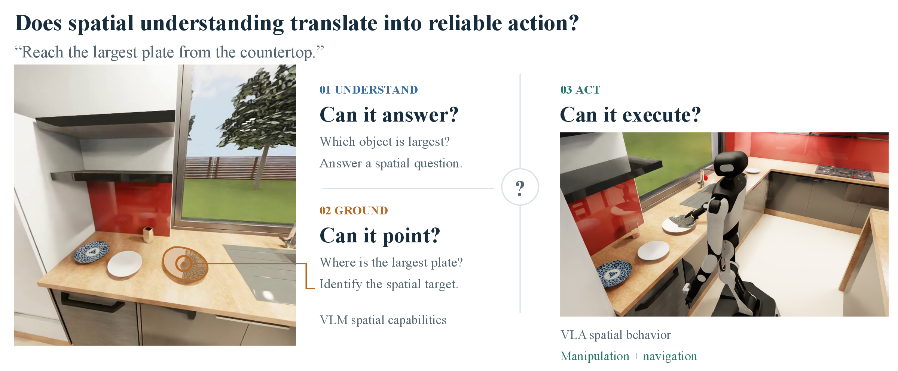

<h1 align="center">BEHAVIOR-Spatial Benchmark: Evaluating Spatial Understanding for Robotics</h1>

<p align="center">
  <a href="https://arielchen07.github.io/behavior-spatial/"></a>
  <a href="https://arxiv.org/abs/2610.34051"></a>
  <a href="https://huggingface.co/datasets/behavior-spatial-benchmark/BEHAVIOR-Spatial"></a>
</p>

<p align="center">
  
</p>

## Contents

- [Overview](#overview)
- [Repository layout](#repository-layout)
- [Environment setup](#environment-setup)
- [Data](#data)
- [Evaluation](#evaluation)
  - [VQA and IR](#vqa-and-ir)
  - [Sim eval](#sim-eval)
  - [Evaluating your own policy](#evaluating-your-own-policy)
  - [Metrics](#metrics)
- [License](#license)
- [Citation](#citation)

## Overview

BEHAVIOR-Spatial is a benchmark built on [BEHAVIOR-1K](https://behavior.stanford.edu/)
that measures whether spatial understanding translates into reliable robot action.
It evaluates the same scenes, objects and spatial relations at three levels, from a
VLM answering spatial questions to a VLA policy acting on spatial instructions:

| Suite | Question | Size |
|---|---|---|
| **BEHAVIOR-Spatial-VQA** (Understand) | Can a VLM answer a spatial question about the scene? | 3,256 questions: 1,572 general (49 activities) + 1,684 task-grounded |
| **BEHAVIOR-Spatial-IR** (Ground) | Can it point to the instructed target? | 1,240 queries over 14 manipulation tasks |
| **BEHAVIOR-Spatial-Action** (Act) | Does a VLA policy carry out the instruction in simulation? | 14 manipulation and 10 navigation tasks |

This repository is the evaluation code: scorers for VQA answers and IR points, and a
method-agnostic sim harness for Action, where your policy runs as a websocket server.
The paper's policies (BEHAVIOR-Spatial-VLA) and their training code are not part of
this release; the training data is on Hugging Face (see [Data](#data)).

## Repository layout

```
bench/vqa_ir/       VQA and IR scorers: score a predictions file against the released data
  score_vqa.py        multiple-choice accuracy, general and task-grounded VQA
  score_ir.py         point-grounding accuracy, strict / tolerant, mean over 14 tasks
  vqa_prompts.py      the VQA prompt and images used for every model in the paper
  prompts.py          the IR prompt used for every model in the paper
bench/sim_eval/     OmniGibson client: rollouts, goal checking, scoring
  run_eval.py         entry point: selects instances, applies protocol.yaml, runs them
  protocol.yaml       canonical per-task settings (rollout budgets, settles, grasps)
  score.py            the paper's metrics: strict / soft / wrong-target, nav success
  eval_subtask.py     manipulation rollouts (reach / place)
  eval_subtask_nav.py navigation rollouts (move_to)
  goal_checker.py     spatial goal predicates and outcome trackers
  summarize_eval_results.py, METRICS.md   outcome buckets and their definitions (all 24 tasks)
  privileged_ir/      oracle target-center projection (only with --with-ir)
examples/           hold_policy_server.py: a minimal policy server to start from
docs/protocol.md    the client ↔ server contract: messages, observation, action, timing
docs/sim_setup.md   installing the two simulator stacks
```

## Environment setup

- **VQA and IR scoring** needs only Python with `numpy`, `Pillow` and `opencv-python`;
  no simulator.
- **Sim eval** needs OmniGibson. The four restaurant_diner navigation tasks need
  OmniGibson 3.9.2; everything else needs 3.7.2. `docs/sim_setup.md` covers both
  stacks and how to check which one is installed.
- **Your policy** runs in its own environment as a websocket server
  (`docs/protocol.md`), so it never shares dependencies with the simulator.

## Data

All benchmark data (questions, frames, ground truth, sim eval instances, training
sets) is on Hugging Face at
[`behavior-spatial-benchmark/BEHAVIOR-Spatial`](https://huggingface.co/datasets/behavior-spatial-benchmark/BEHAVIOR-Spatial).
Below, `$DATA` is your local copy of it.

The dataset is many small files, and Hugging Face rate-limits a full download (HTTP
429). When that happens `hf download` can stop early and still exit 0 with a partial
copy, so download what you need and run the same command again until nothing new
arrives:

```bash
hf download behavior-spatial-benchmark/BEHAVIOR-Spatial --repo-type dataset \
    --local-dir $DATA --include "vqa/*" "ir/*" "action/eval/*" \
    "action/train/navigation_context/*" --max-workers 4
```

The training sets (`action/train/*`) are large; leave them out unless you train.
`action/train/navigation_context/` is the exception: its 77 frames (11 MB) are the
scene-context tours the paper's navigation policies receive at evaluation time too.
`MANIFEST.json` lists the expected count of each component.

## Evaluation

### VQA and IR

Run your VLM on the released questions and score its answers; `bench/vqa_ir/README.md`
gives the predictions format.

```bash
python bench/vqa_ir/score_vqa.py --data $DATA/vqa --predictions answers.json
python bench/vqa_ir/score_ir.py  --data $DATA/ir  --predictions points/
```

### Sim eval

| eval set | what it tests | episodes |
|---|---|---|
| manipulation held-out | unseen scene configurations, from demonstrations not used in training | 469 |
| manipulation prompt-probe | training scene configurations, instruction changed to a different valid target | 700 |
| navigation held-out | spawn-validated unseen start poses, 10 tasks | 401 |

1. Install the simulator stack for the tasks you want to run (`docs/sim_setup.md`).
2. Start a policy server. To check the plumbing first, use the template:
   ```bash
   python examples/hold_policy_server.py --port 8000
   ```
   It holds the robot still, so it should score about 1% or less on manipulation;
   a run that scores it much higher means something is off.
3. In the OmniGibson environment, run a slice and score it:
   ```bash
   python bench/sim_eval/run_eval.py --eval-root $DATA/action/eval/manipulation \
       --slice held_out --host localhost --port 8000 --out runs/my_method
   python bench/sim_eval/score.py --results runs/my_method
   ```
   `--dry-run` prints the resolved instances, settings and commands without running.
   Use `--slice prompt_probe` for the prompt-probe set. `--task` takes one or more
   task directories (`--task reach_plate,reach_dice`).

   Navigation spans both simulator stacks, so run it once in each environment into
   the same `--out`; `run_eval.py` skips groups that need the other stack:
   ```bash
   # OmniGibson 3.7.2 environment: the six house-scene tasks
   python bench/sim_eval/run_eval.py --eval-root $DATA/action/eval/navigation --slice held_out \
       --task bathroom,bookcase,fridge,garage,table_in_kitchen,table_near_sofa --out runs/my_method
   # OmniGibson 3.9.2 environment: the four restaurant_diner tasks
   python bench/sim_eval/run_eval.py --eval-root $DATA/action/eval/navigation --slice held_out \
       --task bar,corner_booth,kitchen_sink,oven --out runs/my_method
   ```
   The harness sends the instruction and live observations only. The paper's
   navigation policies also see the scene's context tour, which the policy server
   loads itself from `$DATA/action/train/navigation_context/<scene>/`.

   Rollouts are slow: with the template policy on one L40S, a 3,000-step
   manipulation episode takes about 12 minutes plus a few minutes of scene loading
   per group. Budgets range from 3,000 to 7,000 steps (manipulation) and 8,000 to
   30,000 (navigation), so split a slice across GPUs with `--task` or `--config`.

### Evaluating your own policy

Replace `HoldPolicy` in the template (or implement `docs/protocol.md` in any
language), and report results with the unmodified `protocol.yaml`. Results with
`--with-ir` use simulator ground truth and must be reported as privileged; they are
written to `<task>_ir/` directories, and `score.py` reports them in a separate
"[privileged IR]" block.

### Metrics

Soft success is the primary manipulation metric, reported with strict success and
the wrong-target rate; navigation reports success. `bench/sim_eval/METRICS.md`
defines the outcome buckets behind each metric for all 24 tasks.

## License

The code is Apache-2.0 (`LICENSE`); `NOTICE` lists the OmniGibson-derived parts
(MIT). The dataset is MIT (see its card). Running the sim eval also needs
BEHAVIOR-1K / OmniGibson, Isaac Sim and the BEHAVIOR-1K scene and object assets,
each under its own license and terms.

## Citation

```bibtex
@article{chen2026behaviorspatial,
  title   = {{BEHAVIOR-Spatial} Benchmark: Evaluating Spatial Understanding for Robotics},
  author  = {Chen, Sirui and Huang, Huang and Wang, Qineng and Huang, Wenlong and Li, Manling and Zhang, Ruohan and Fei-Fei, Li and Wu, Jiajun},
  journal = {arXiv preprint arXiv:2610.34051},
  year    = {2026}
}
```
